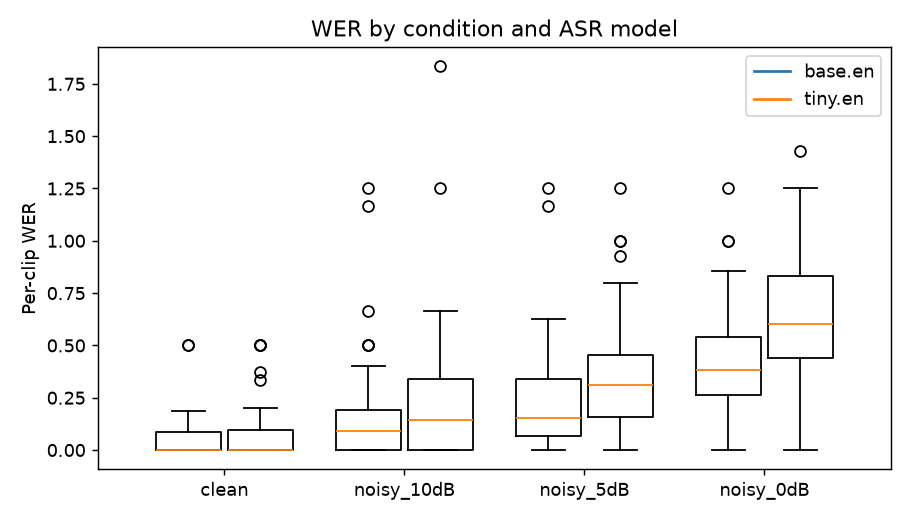
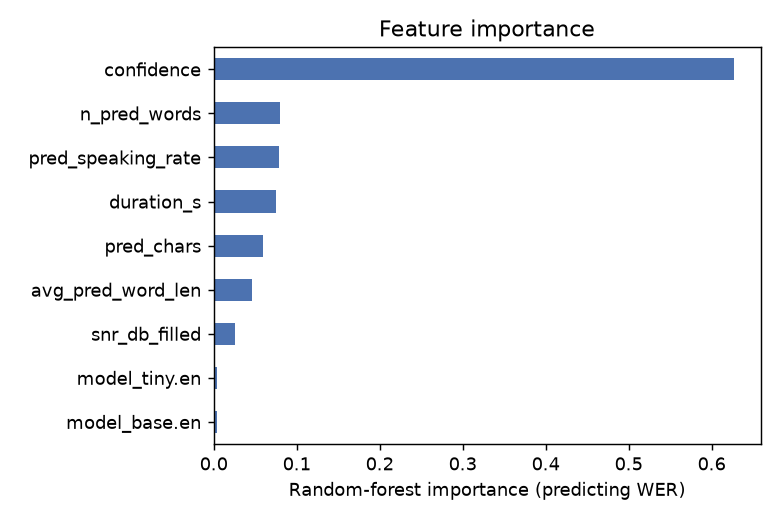
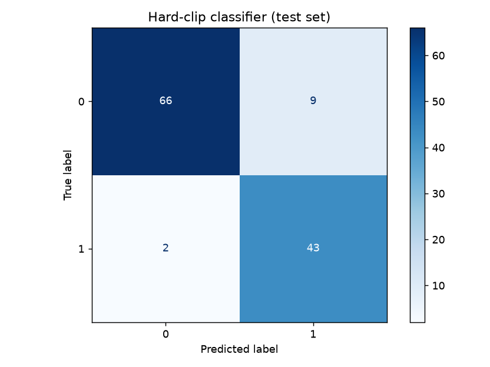
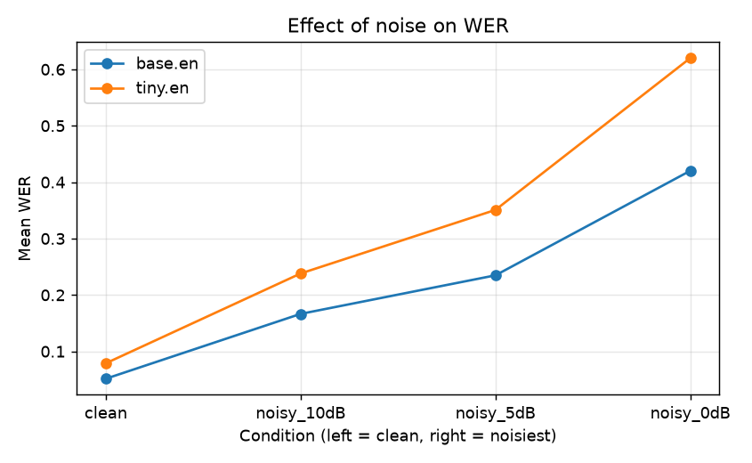

# Speech to Text: Transcribe English Audio, Then Analyse the Text

We convert English speech to text with **pretrained** speech recognition models (Whisper, via `faster-whisper`;
nothing is trained from scratch), store the data with numpy, pandas and SQLite, run exploratory data analysis, and
then analyse the transcripts with keyword detection, matching to the expected answer, and machine-learning models
that predict how hard a clip is for the recogniser.

We also ran two extensions: **clear vs noisy audio** (white noise at 10, 5 and 0 dB) and a **comparison of two ASR
systems** (Whisper `tiny.en` vs `base.en`).

## Main findings

* `base.en` is more accurate than `tiny.en` in every condition: mean word error rate (WER) on clean audio is 5.2%
  vs 7.9%, and at 0 dB noise it is 42.0% vs 61.2%.
* Noise hurts a lot. For `base.en`, WER goes from 5.2% (clean) to 42.0% (0 dB). Words are missed more often than they are
  invented: keyword recall falls faster than keyword precision.
* The recogniser's own confidence score is the best predictor of WER (correlation -0.73). A logistic-regression model
  that predicts "hard clip" (WER above 15%) from confidence, noise and speaking-rate features reaches F1 = 0.89
  (majority baseline: 0.55).

## Contents

1. [Pipeline and folder structure](#1-pipeline-and-folder-structure)
2. [Setup](#2-setup)
3. [How to run](#3-how-to-run)
4. [Data](#4-data)
5. [Database](#5-database)
6. [Speech-to-text](#6-speech-to-text)
7. [WER evaluation and EDA](#7-wer-evaluation-and-eda)
8. [Text analysis](#8-text-analysis-keyword-detection-and-answer-matching)
9. [Features and machine learning](#9-features-and-machine-learning)
10. [Extension: clear vs noisy audio and two ASR systems](#10-extension-clear-vs-noisy-audio-and-two-asr-systems)
11. [Limitations](#11-limitations)
12. [Team](#12-team)

## 1. Pipeline and folder structure

```
data_prep -> transcribe -> metrics (WER) -> eda -> text_tasks -> features -> train_model -> compare_conditions -> evaluate
```

```
.
|-- README.md
|-- requirements.txt
|-- data/
|   |-- sample_audio/        5 example clean clips
|   |-- manifest.csv         list of all clips (filename, condition, duration, true transcript)
|   |-- audio/               full audio subset (created by data_prep, not committed)
|   `-- speech_project.db    SQLite database (created by data_prep, not committed)
|-- outputs/                 transcripts, metrics, reports, plots
`-- src/
    |-- config.py            paths and settings
    |-- text_utils.py        text normalisation helpers
    |-- database.py          SQLite read / write / modify
    |-- data_prep.py         download subset, create noisy versions, build manifest
    |-- transcribe.py        speech-to-text with Whisper
    |-- metrics.py           word error rate
    |-- eda.py               exploratory data analysis
    |-- text_tasks.py        keyword detection and transcript matching
    |-- features.py          feature engineering, correlation, PCA, importance
    |-- train_model.py       regression and classification models
    |-- compare_conditions.py  noise and ASR-system comparison
    `-- evaluate.py          final report and evaluation plots
```

## 2. Setup

```bash
git clone https://github.com/Jedop/IDC409-Group-Project-13.git
cd IDC409-Group-Project-13
python -m venv .venv
source .venv/bin/activate          # Windows: .venv\Scripts\activate
pip install -r requirements.txt
```

Python 3.9 or newer is required. `faster-whisper` downloads the Whisper model files the first time it runs, so an
internet connection is needed once (about 75 MB for `tiny.en`, 145 MB for `base.en`). A separate ffmpeg install is not needed.
Everything runs on CPU.

## 3. How to run

Run the commands from the project root, in this order:

```bash
python -m src.data_prep                     # download subset, create noisy copies, fill manifest + database
python -m src.transcribe --model tiny.en    # speech-to-text, first ASR system
python -m src.transcribe --model base.en    # speech-to-text, second ASR system
python -m src.metrics                       # word error rate
python -m src.eda                           # exploratory data analysis
python -m src.text_tasks                    # keyword detection and answer matching
python -m src.features                      # feature analysis and reduction
python -m src.train_model                   # ML models
python -m src.compare_conditions            # noise and ASR comparison
python -m src.evaluate                      # final report
```

Transcription took roughly 1 to 3 minutes per model on a laptop CPU (240 clips each). It saves progress in batches,
so an interrupted run can be restarted and finished clips are skipped. Use `--limit 5` for a quick test.

## 4. Data

* **Source:** LibriSpeech `dev-clean` (<https://www.openslr.org/12>), read English speech from audiobooks.
* **Subset:** 60 clips from 6 speakers (10 clips each), each at most 15 seconds, converted to 16 kHz mono wav.
  `data_prep.py` streams the archive and stops as soon as enough clips are found, so the full archive is not downloaded.
* **Noisy copies:** every clean clip is copied with white Gaussian noise added at **10, 5 and 0 dB** signal-to-noise
  ratio (numpy). This gives four conditions with 60 clips each, **240 clips in total**: `clean`, `noisy_10dB`, `noisy_5dB`, `noisy_0dB`.
* **Stored per clip:** audio filename, true transcript, predicted transcript, confidence, notes (and the WER once computed).
* **Own recordings (optional):** wav/flac clips with a CSV (`filename,true_text`) can be added with
  `python -m src.data_prep --skip-download --own-csv <folder>/recordings.csv`. They get the condition `accent_indian`
  and flow through all later steps. We did not use this option in the results below.

`data/sample_audio/` contains 5 clean clips. The rest of the audio is re-created by `data_prep.py`.

## 5. Database

`src/database.py` uses SQLite (`data/speech_project.db`) with two tables:

| table | columns |
| --- | --- |
| `clips` | clip_id, source_clip_id, filename, filepath, condition, snr_db, duration_s, sample_rate, true_text |
| `transcripts` | id, clip_id, asr_model, predicted_text, confidence, notes, wer |

* **write:** `insert_clips`, `insert_transcripts`
* **read:** `read_clips`, `read_transcripts`, `read_joined`
* **modify:** `update_notes`, `update_wer`
* **delete:** `delete_transcripts`, `delete_clip`

`python -m src.database` runs a short read -> modify -> restore demo. Data is handled in pandas DataFrames and numpy arrays.

## 6. Speech-to-text

We use **faster-whisper** (a fast CPU implementation of OpenAI Whisper) with two pretrained English models,
`tiny.en` and `base.en`. For each clip `src/transcribe.py`:

1. runs the model (`beam_size=5`, language `en`);
2. normalises the text (lowercase, punctuation removed) so it can be compared with the LibriSpeech transcript;
3. computes a **confidence** score: the duration-weighted `exp(avg_logprob)` over the segments;
4. adds **notes** (`empty transcript`, or `low confidence` when confidence is below 0.50);
5. saves the result to the database and to `outputs/transcripts_<model>.csv` and `.txt`.

Confidence is the average probability Whisper gave to the words it chose. It is not the probability that the transcript
is correct: good transcripts typically score 0.6 to 0.8, and the score drops as audio gets noisier.

## 7. WER evaluation and EDA

**Word error rate** = (substitutions + deletions + insertions) / words in the true transcript, computed with `jiwer`
after normalising both texts. We report the mean per-clip WER and the corpus WER (total errors / total words).

Dataset statistics (60 clean clips):

| | mean | min | max |
| --- | --- | --- | --- |
| duration (s) | 5.21 | 1.56 | 15.00 |
| words per transcript | 15.6 | 4 | 48 |
| characters per transcript | 81.0 | 17 | 276 |
| speaking rate (words/s) | 2.96 | 2.11 | 4.01 |

EDA outputs are in `outputs/eda_summary.txt`, `outputs/error_examples.csv` and `outputs/plots/`
(duration, word count, transcript length vs duration, WER by condition, confidence vs WER).



**What the error examples show**

* On clean audio most errors involve names and rare words ("carrie" -> "kerry", "chanticleer" -> "shanti claire").
* Spelling conventions count as errors even when the speech was understood: Whisper writes "24" where LibriSpeech has
  "twenty four", and "a while" where LibriSpeech has "awhile".
* At 0 dB the worst clips are almost completely wrong, e.g. the true transcript "ask karl yundt he growled savagely"
  became "that's probably done it's done it's done it's done it it's done" (WER 2.50, more than 100% because of repeated insertions).
* Confidence and WER are strongly negatively correlated (r = -0.73).

## 8. Text analysis (keyword detection and answer matching)

**Keyword detection.** The 20 most common content words of the clean true transcripts (stop words and words shorter than
4 letters removed) are the keywords: *time, came, antonia, like, poor, said, long, little, eyes, answer, rang, carrie,
loud, otto, seen, years, white, snake, good, slight*. The true transcript is the ground truth and the predicted transcript
is the detection, giving precision, recall and F1.

| ASR model | condition | precision | recall | F1 |
| --- | --- | --- | --- | --- |
| base.en | clean | 0.977 | 0.935 | 0.956 |
| base.en | 10 dB | 0.944 | 0.739 | 0.829 |
| base.en | 5 dB | 0.868 | 0.717 | 0.786 |
| base.en | 0 dB | 0.793 | 0.500 | 0.613 |
| tiny.en | clean | 0.976 | 0.870 | 0.919 |
| tiny.en | 10 dB | 0.872 | 0.739 | 0.800 |
| tiny.en | 5 dB | 0.886 | 0.674 | 0.765 |
| tiny.en | 0 dB | 0.618 | 0.457 | 0.525 |

**Matching to the expected answer.** Each predicted transcript is compared with the expected transcript.
*Exact match* means the normalised texts are identical; *fuzzy match* means `difflib` similarity of at least 0.85.

| ASR model | condition | exact accuracy | fuzzy accuracy | mean similarity |
| --- | --- | --- | --- | --- |
| base.en | clean | 0.667 | 0.983 | 0.987 |
| base.en | 10 dB | 0.350 | 0.883 | 0.936 |
| base.en | 5 dB | 0.150 | 0.700 | 0.890 |
| base.en | 0 dB | 0.033 | 0.367 | 0.797 |
| tiny.en | clean | 0.517 | 0.950 | 0.974 |
| tiny.en | 10 dB | 0.267 | 0.767 | 0.906 |
| tiny.en | 5 dB | 0.083 | 0.567 | 0.843 |
| tiny.en | 0 dB | 0.033 | 0.167 | 0.692 |

## 9. Features and machine learning

**Question:** can we predict how badly the ASR system will do on a clip, without knowing the true transcript?

**Data:** one row per clip and ASR model (480 rows). **Targets:** `wer` (regression) and `hard` = WER above 0.15
(classification; 37.5% of the test rows are "hard").

**Features** (only information available without the true transcript, to avoid leakage): `duration_s`, `snr_db_filled`
(clean clips get a stand-in value of 40 dB), `n_pred_words`, `pred_chars`, `avg_pred_word_len`, `pred_speaking_rate`,
`confidence`, and one-hot columns for the ASR model (9 features).

**Feature understanding and reduction** (`outputs/feature_analysis.txt`, `outputs/plots/features_*.png`):

* Correlation filter (|r| > 0.90) removed `n_pred_words`, `pred_chars` and `model_tiny.en`, leaving 6 features.
* PCA: 5 components explain 95% of the variance of the 9 features.
* Random-forest importance: `confidence` 0.587, `pred_speaking_rate` 0.137, `duration_s` 0.074, `n_pred_words` 0.074,
  `pred_chars` 0.054, `avg_pred_word_len` 0.041, `snr_db_filled` 0.026. Confidence dominates, probably because it already
  reflects how noisy the clip was.



**Models** (`src/train_model.py`): each model was trained on three feature sets (all features, correlation-reduced, PCA 95%).
The 75% / 25% train/test split is grouped by the original clip, so the clean and noisy copies of one clip are never on both sides
(360 training rows, 120 test rows).

| task | models |
| --- | --- |
| regression (predict WER) | mean baseline, linear regression, decision tree, random forest, SVR, neural network (MLP) |
| classification (hard clip?) | majority baseline, logistic regression, decision tree, random forest, SVM, neural network (MLP) |

**Regression results (test set, best per model; lower MAE is better)**

| model | feature set | MAE | RMSE | R2 |
| --- | --- | --- | --- | --- |
| decision tree | all | 0.115 | 0.180 | 0.526 |
| random forest | all | 0.120 | 0.169 | 0.584 |
| linear regression | reduced | 0.132 | 0.173 | 0.562 |
| neural network | pca95 | 0.142 | 0.189 | 0.480 |
| SVR | all | 0.143 | 0.193 | 0.454 |
| mean baseline | - | 0.237 | 0.277 | -0.124 |

**Classification results (test set, best per model)**

| model | feature set | accuracy | precision | recall | F1 |
| --- | --- | --- | --- | --- | --- |
| logistic regression | all (same for reduced, pca95) | 0.908 | 0.827 | 0.956 | 0.887 |
| SVM | reduced (same for pca95) | 0.875 | 0.759 | 0.978 | 0.854 |
| decision tree | reduced | 0.842 | 0.741 | 0.889 | 0.808 |
| neural network | all | 0.833 | 0.705 | 0.956 | 0.811 |
| random forest | pca95 | 0.817 | 0.677 | 0.978 | 0.800 |
| majority baseline | - | 0.375 | 0.375 | 1.000 | 0.545 |

All models clearly beat the baselines. The decision tree has the lowest MAE, the random forest the highest R2.
Reducing the features from 9 to 6 changed the scores very little, so the removed features were redundant.
PCA did not help (it hurt the tree-based models).



## 10. Extension: clear vs noisy audio and two ASR systems

Mean per-clip WER (60 clips per cell):

| ASR model | clean | 10 dB | 5 dB | 0 dB |
| --- | --- | --- | --- | --- |
| tiny.en | 0.079 | 0.238 | 0.376 | 0.612 |
| base.en | 0.052 | 0.166 | 0.232 | 0.420 |

Corpus WER (total errors / total words):

| ASR model | clean | 10 dB | 5 dB | 0 dB |
| --- | --- | --- | --- | --- |
| tiny.en | 0.064 | 0.187 | 0.312 | 0.572 |
| base.en | 0.046 | 0.130 | 0.194 | 0.398 |



**Paired comparison of the two models** (240 clips): mean WER 0.218 for `base.en` vs 0.326 for `tiny.en`. `base.en` was better on
136 clips, `tiny.en` on 20, and 84 were tied (Wilcoxon signed-rank test, p < 0.001). The larger model is more robust
to noise: from clean to 0 dB its WER rises by 0.37, against 0.53 for `tiny.en`.

## 11. Limitations

* LibriSpeech is clean, read book speech, mostly standard accents, so it is easier than real conversations.
* The dataset is small: 60 clips (about 5 minutes of clean audio) from 6 speakers.
* The ML test set holds only 120 rows, which come from about 15 original clips (each clip appears in four conditions and
  with two ASR models), so the scores vary with the split. We also picked the "best" model on that same test set, so the
  reported scores are slightly optimistic. A larger dataset and cross-validation would give more reliable numbers.
* Noise is synthetic white noise at fixed levels; real background noise (traffic, crowds, music) behaves differently.
* "Clean" clips have an unknown real SNR; 40 dB is only a stand-in value for the feature.
* WER counts spelling differences ("24" vs "twenty four", "a while" vs "awhile") and name errors as mistakes, even when
  the speech was recognised correctly.
* In very noisy audio Whisper sometimes produces text that was never spoken, including repeated phrases and occasionally
  offensive words, instead of an empty transcript.
* Keywords are the most frequent words of this subset, not a real command vocabulary.
* We did not run the optional accented-speech extension, so nothing here says how the models perform on Indian-accented speech.
* Everything runs on CPU with the two smallest Whisper models; larger models would be more accurate but slower.

## 12. Team

* Avneesh Singh MS23249
* Prithwish Pathank MS23250
* Karthik Nair MS23253

## Data source and credits

* LibriSpeech corpus: Panayotov et al., 2015, <https://www.openslr.org/12> (CC BY 4.0).
* Whisper: OpenAI; `faster-whisper` by SYSTRAN.
* Libraries: numpy, pandas, scikit-learn, scipy, matplotlib, soundfile, jiwer.
